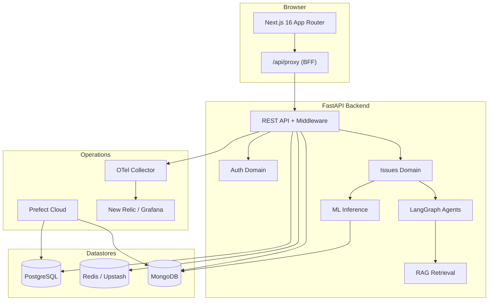
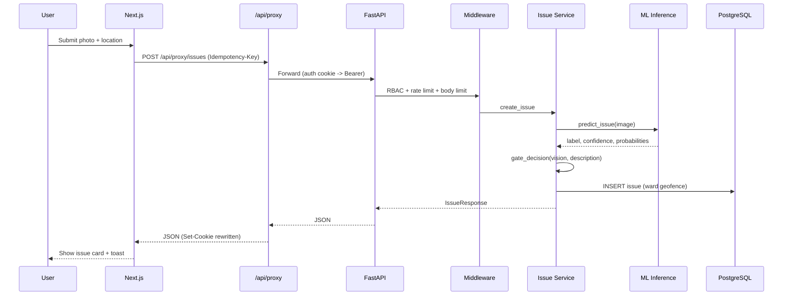
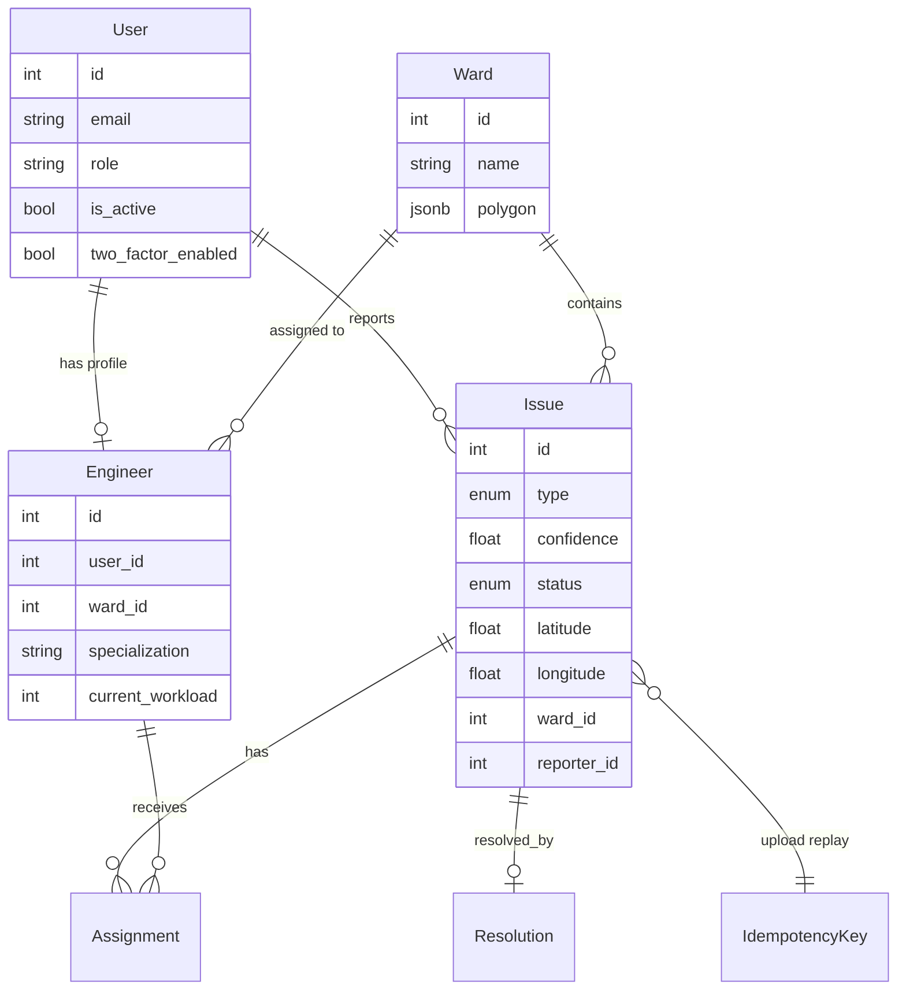
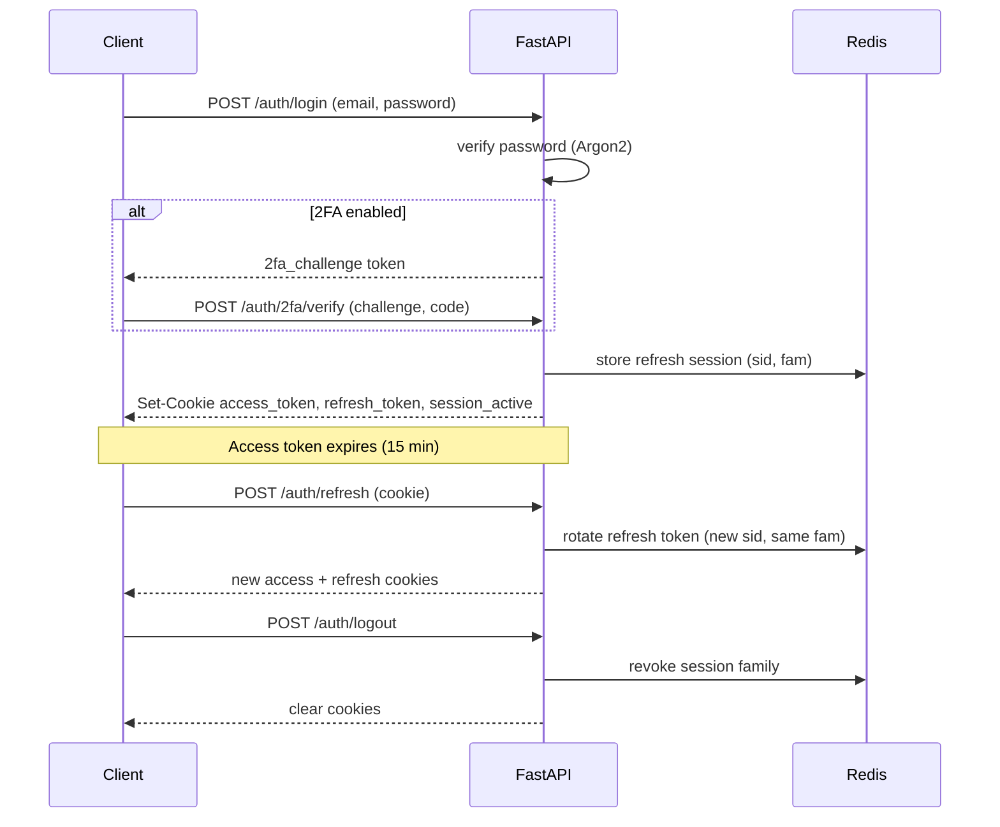
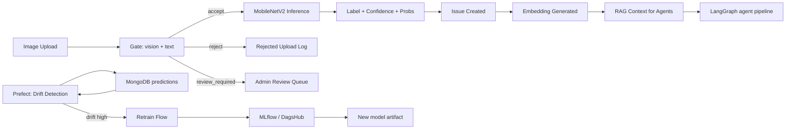
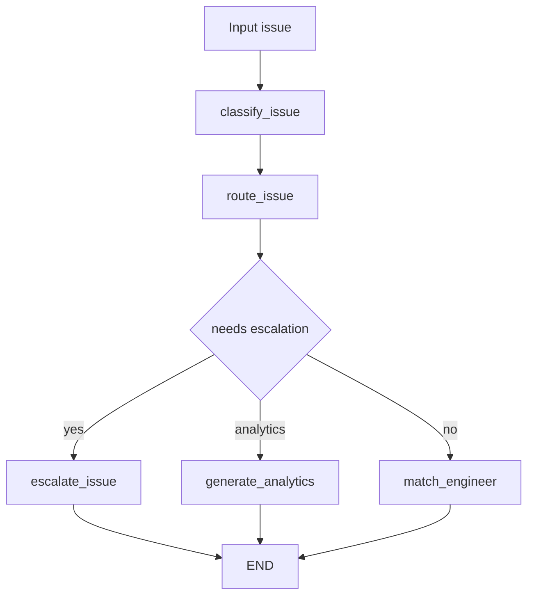
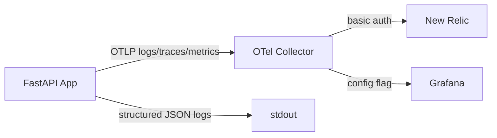
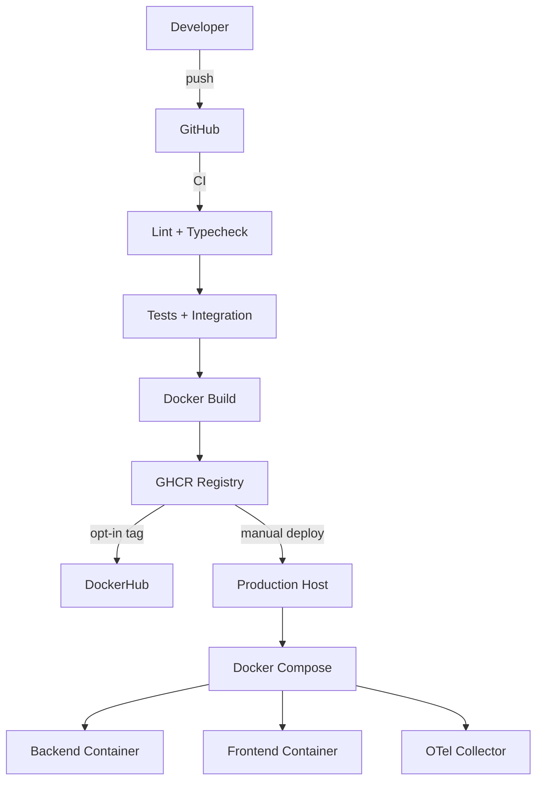

# CivicPulse — AI-Based Civic Issue Monitoring System

A production-grade platform for reporting, classifying, and resolving civic issues
(potholes, garbage, debris) for the Vadodara Municipal Corporation. Citizens
submit geo-tagged photos; a computer-vision model classifies them; LangGraph
agents route, escalate, and assign work to engineers; a Next.js dashboard tracks
resolution end-to-end. Scheduled drift detection keeps the model honest.


## Table of contents

- [Architecture](#architecture)
- [Request lifecycle](#request-lifecycle)
- [Data model](#data-model)
- [Authentication flow](#authentication-flow)
- [ML pipeline](#ml-pipeline)
- [Observability](#observability)
- [Deployment](#deployment)
- [Setup](#setup)
- [Commands](#commands)

## Architecture



### Component responsibilities

| Layer | Component | Responsibility |
| ----- | --------- | -------------- |
| Frontend | Next.js App Router | Dashboard, map, admin/review, issue reporting |
| Frontend | BFF proxy (`/api/proxy`) | Auth cookie scoping, path allowlist, body limits |
| Backend | FastAPI + middleware | RBAC, rate limiting, request logging, metrics |
| Backend | Auth domain | JWT access/refresh, TOTP 2FA, OAuth, sessions |
| Backend | Issues domain | Upload, gate, classify, assign, resolve, idempotency |
| Backend | ML inference | MobileNetV2 (PyTorch/ONNX), drift logging |
| Backend | LangGraph agents | Classify, route, match, escalate, analytics |
| Backend | RAG | Vector + BM25 hybrid retrieval over issue history |
| Data | PostgreSQL | Users, issues, wards, engineers, assignments |
| Data | Redis | Rate limits, cache, token blacklist, sessions |
| Data | MongoDB | Audit logs, drift reports, rejected uploads |
| Ops | Prefect | Drift, SLA, reporting, retraining flows |
| Ops | OTel collector | Fan-out to New Relic / Grafana |

## Request lifecycle



## Data model



## Authentication flow



## ML pipeline



### Agent graph



## Observability



Three layers: app instruments (FastAPI, httpx, SQLAlchemy, HTTP middleware) export over OTLP to a Layer-2 collector that owns the vendor key and fans out to any OTLP sink. No Prometheus scrape path.

## Deployment



## Setup

### Prerequisites

- [Pixi](https://pixi.sh) (conda-forge)
- Node.js 22 LTS + npm
- Docker + Docker Compose (optional)

### Install

```bash
git clone https://github.com/BORUTOUZUMAKI07/ai-civic-issue-monitoring.git
cd ai-civic-issue-monitoring

pixi install
cd frontend && npm install && cd ..

cp backend/.env.example backend/.env
# edit backend/.env: SECRET_KEY, DATABASE_URL, REDIS_URL, MONGODB_URI

pixi run setup
```

### First admin

```bash
ADMIN_EMAIL=you@example.com ADMIN_PASSWORD='<12+ chars>' ADMIN_ROLE=super_admin pixi run create-admin
```

### Run

```bash
pixi run dev            # backend :8000
pixi run frontend       # frontend :3000
```

Or full stack:

```bash
cp docker/.env.example docker/.env   # set SECRET_KEY
docker compose -f docker/docker-compose.yml --profile dev up --build
```

## Commands

Backend:

```bash
pixi run dev            # hot-reload server
pixi run test           # tests
pixi run test-ci        # tests (skip integration)
pixi run lint           # ruff
pixi run lint-fix       # ruff auto-fix
pixi run typecheck      # mypy
pixi run format         # ruff format
pixi run migrate        # alembic upgrade head
pixi run migrate-create # new migration
pixi run seed           # seed wards
pixi run train          # train ML model
pixi run create-admin   # bootstrap first admin
```

Frontend:

```bash
pixi run frontend       # dev server
pixi run frontend-build # production build
pixi run frontend-test  # vitest
```

Data (DVC):

```bash
dvc pull
dvc add models/model.onnx && dvc push
```

## Features

- Real-time classification: MobileNetV2 image classifier with keyword fallback
- Agent pipeline: LangGraph routing, escalation, engineer matching
- Intake gate: vision + description three-way accept/reject/review
- Ward geofencing: point-in-polygon assignment
- Idempotent uploads with `Idempotency-Key`
- Refresh-token rotation with family revocation
- TOTP two-factor auth with recovery codes
- OAuth (Google, GitHub)
- RBAC: super_admin / admin / engineer / field_worker / viewer
- Real-time issue stream over WebSocket
- Admin review queue, user management, engineer roster
- Dashboard stats, heatmap, public aggregate stats
- Drift detection via Prefect
- SLA monitoring and daily reports
- OTLP observability to a Layer-2 collector

## Tech stack

Backend: FastAPI, SQLAlchemy 2.0 (async), PostgreSQL, Beanie + MongoDB,
Redis/Upstash, LangGraph, PyTorch + MobileNetV2, PyJWT.

Frontend: Next.js 16, React 19, Tailwind CSS v4, shadcn/ui (Radix), TanStack
Query, Leaflet, Recharts.

DevOps: Pixi, Docker Compose, Prefect Cloud, GitHub Actions, OpenTelemetry.

## Documentation

- [`docs/deployment.md`](docs/deployment.md) — deployment runbook
- [`docs/adr/`](docs/adr/) — architecture decision records
